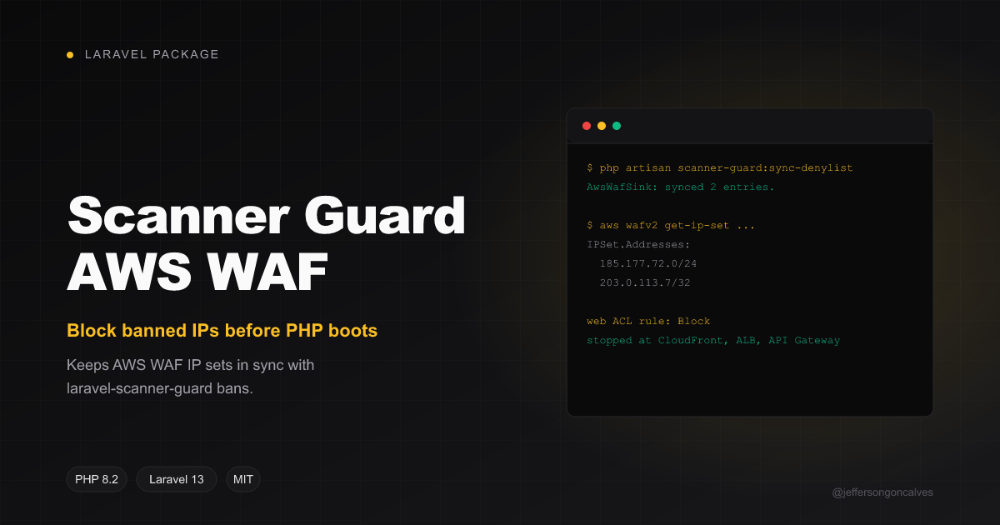

<div class="filament-hidden">



</div>

# Laravel Scanner Guard AWS WAF

[](https://packagist.org/packages/jeffersongoncalves/laravel-scanner-guard-aws-waf)
[](https://github.com/jeffersongoncalves/laravel-scanner-guard-aws-waf/actions/workflows/tests.yml)
[](https://packagist.org/packages/jeffersongoncalves/laravel-scanner-guard-aws-waf)

AWS WAF denylist sink for [`laravel-scanner-guard`](https://github.com/jeffersongoncalves/laravel-scanner-guard).
Keeps AWS WAF **IP sets** in sync with your bans and `ip_blocklist`, so a web ACL rule blocks them at
CloudFront, an Application Load Balancer or API Gateway: banned scanners never reach your servers.

## Installation

```bash
composer require jeffersongoncalves/laravel-scanner-guard-aws-waf
```

Add the sink to `config/scanner-guard.php`:

```php
'sinks' => [
    \JeffersonGoncalves\ScannerGuardAwsWaf\AwsWafSink::class,
],
```

## AWS setup

1. **Create the IP sets.** AWS has no mixed set, so one for IPv4 and one for IPv6. The sink **replaces
   the whole set** on every change, so give it sets of its own:

   ```bash
   aws wafv2 create-ip-set --name scanner-guard-v4 --scope REGIONAL --region sa-east-1 \
     --ip-address-version IPV4 --addresses
   aws wafv2 create-ip-set --name scanner-guard-v6 --scope REGIONAL --region sa-east-1 \
     --ip-address-version IPV6 --addresses
   ```

   For CloudFront use `--scope CLOUDFRONT --region us-east-1`.

2. **Block them.** In the web ACL of your load balancer, API or distribution, add one rule per set:
   *Originates from an IP address in* → the set → action **Block**. Put them first.

3. **Allow the app to write them:**

   ```json
   {
     "Version": "2012-10-17",
     "Statement": [
       {
         "Effect": "Allow",
         "Action": ["wafv2:GetIPSet", "wafv2:UpdateIPSet"],
         "Resource": [
           "arn:aws:wafv2:sa-east-1:123456789012:regional/ipset/scanner-guard-v4/*",
           "arn:aws:wafv2:sa-east-1:123456789012:regional/ipset/scanner-guard-v6/*"
         ]
       }
     ]
   }
   ```

4. **Configure the app** with the ARNs. Region and scope come from them:

   ```dotenv
   SCANNER_GUARD_AWS_WAF_IPV4_ARN=arn:aws:wafv2:sa-east-1:123456789012:regional/ipset/scanner-guard-v4/...
   SCANNER_GUARD_AWS_WAF_IPV6_ARN=arn:aws:wafv2:sa-east-1:123456789012:regional/ipset/scanner-guard-v6/...
   ```

Run `php artisan scanner-guard:sync-denylist` once to check: it exits non-zero and logs the AWS error
if something is wrong.

## How it syncs

`scanner-guard:sync-denylist` runs every minute and right after every ban, unban and blocklist change.
The sink reads the set's lock token (`GetIPSet`) and replaces its addresses (`UpdateIPSet`). A SHA-256
of the last list written to each set is kept in the scanner-guard cache store, so an unchanged list
costs no API call: in practice AWS is only called when a ban starts or ends. AWS takes a little while
to apply a change everywhere.

- An API error (including a lock token that went stale because something else changed the set) throws:
  `sync-denylist` logs it, exits non-zero and keeps running your other sinks. Nothing is cached, so the
  next sync retries.
- A set holds 10,000 addresses. Beyond that the first 10,000 are kept (`ip_blocklist` entries, then the
  bans with the latest expiry) and a warning is logged. The app still blocks the rest.
- AWS rejects `/0`: such an `ip_blocklist` entry is skipped here (logged as a warning) but still
  blocked by the app. Host bits are cleared (`10.1.2.3/8` becomes `10.0.0.0/8`).
- Leave an ARN empty to keep that IP version out of AWS. At least one is required.
- IP sets have no comments, so reasons and expiries stay in the app.

## Configuration

```bash
php artisan vendor:publish --tag="laravel-scanner-guard-aws-waf-config"
```

| Key | Env | Default |
|---|---|---|
| `ipv4_arn` | `SCANNER_GUARD_AWS_WAF_IPV4_ARN` | `null` |
| `ipv6_arn` | `SCANNER_GUARD_AWS_WAF_IPV6_ARN` | `null` |
| `credentials` | `AWS_ACCESS_KEY_ID`, `AWS_SECRET_ACCESS_KEY`, `AWS_SESSION_TOKEN` | the SDK's default chain (EC2, ECS or EKS role, profile) |
| `client` | | HTTP timeouts (5s connect, 10s total) |

`client` is passed to `Aws\WAFV2\WAFV2Client`. The AWS SDK ships every service: to keep only this one
in your app, see [`aws/aws-sdk-php`'s `removeUnusedServices`](https://github.com/aws/aws-sdk-php/tree/master/src/Script/Composer)
(list `WAFV2` and whatever else you use).

## Behind CloudFront or a load balancer: the app needs the visitor's IP

scanner-guard bans whatever `$request->ip()` returns. Behind a load balancer or CloudFront that is
their IP unless the app trusts them in `TrustProxies`. Otherwise the app bans its own proxy (rejecting
real visitors itself), so check `$request->ip()` before turning the sink on.

The web ACL matches the address that connects to the resource it protects. On a load balancer behind
CloudFront or another CDN, attach the ACL to the distribution instead, or set the rule to read the IP
from a header, and only if nothing can reach the load balancer directly (the header can be forged).

## Testing

```bash
composer test
```

`SERVER_TESTS=1 composer test` also runs the sink against [Moto](https://github.com/getmoto/moto), a
mock of AWS (needs Docker).

## Changelog

Please see [CHANGELOG](CHANGELOG.md) for more information on what has changed recently.

## Credits

- [Jefferson Gonçalves](https://github.com/jeffersongoncalves)
- [All Contributors](../../contributors)

## License

The MIT License (MIT). Please see [License File](LICENSE.md) for more information.
